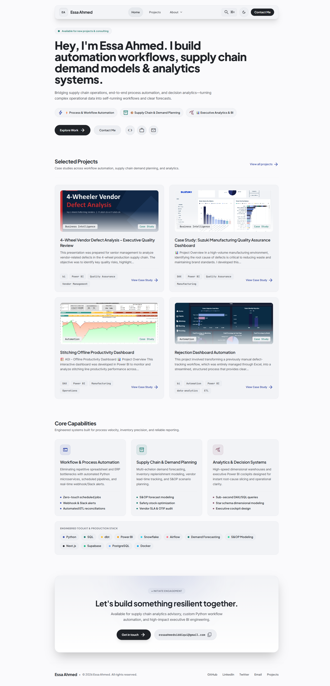

# Portfolio Website

A responsive portfolio website for presenting professional capabilities, project case studies, and articles. The repository includes an admin area for maintaining the public profile and published content.



## Features

- Responsive home page with selected work and professional capabilities.
- Project listings and case study detail pages.
- Article publishing with categories, tags, and series.
- Light and dark themes.
- Protected admin pages for managing profile, projects, and articles.

## Requirements

- Node.js 18.18 or newer
- npm 9 or newer
- A Supabase project

## Run locally

1. Clone the repository and open the project directory:

   ```bash
   git clone https://github.com/OWNER/REPOSITORY.git
   cd REPOSITORY
   ```

   Replace `OWNER/REPOSITORY` with the GitHub location for your copy.

2. Install dependencies:

   ```bash
   npm ci
   ```

3. Copy the environment template and add your Supabase project credentials:

   ```bash
   cp .env.example .env.local
   ```

   On Windows PowerShell, use `Copy-Item .env.example .env.local`.

   ```env
   NEXT_PUBLIC_SUPABASE_URL=https://your-project-id.supabase.co
   NEXT_PUBLIC_SUPABASE_PUBLISHABLE_KEY=sb_publishable_your-key
   ```

   Existing deployments may use `NEXT_PUBLIC_SUPABASE_ANON_KEY`; the app accepts either variable. Use only publishable/anon keys in frontend environments, never a service-role or secret key.

4. Apply the SQL files in `supabase/migrations` to your Supabase project in filename order. The included migrations are incremental; provision the base project and article tables before applying them if starting from a blank database. Add your local and deployed URLs to the Supabase Auth redirect URL settings.

5. Start the development server:

   ```bash
   npm run dev
   ```

   Open [http://localhost:3000](http://localhost:3000).

## Admin access

Create a user with Supabase Auth, then grant that account the trusted app metadata claim `{"role":"admin"}` from the Supabase Dashboard or Admin API. Sign out and back in after changing the claim. Do not use editable user metadata for administrator access.

## Useful commands

| Command | Purpose |
| --- | --- |
| `npm run dev` | Start the local development server |
| `npm run build` | Create a production build |
| `npm run start` | Serve the production build |
| `npm test` | Run the end-to-end checks |

## Deployment

Deploy with a host that supports Next.js, such as Vercel. Set `NEXT_PUBLIC_SUPABASE_URL` and either `NEXT_PUBLIC_SUPABASE_PUBLISHABLE_KEY` or `NEXT_PUBLIC_SUPABASE_ANON_KEY` in the deployment environment, then configure the deployed site URL in Supabase Auth settings.

## Customizing

Update the profile and published content for your own portfolio. Replace the homepage screenshot at `docs/screenshots/portfolio-homepage.png` when you capture your customized site. Keep credentials and other secrets out of source control.
